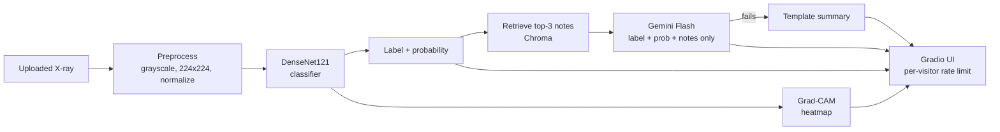
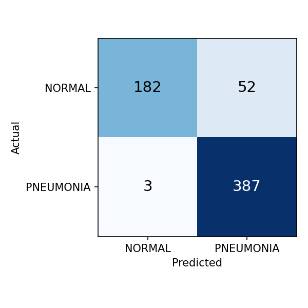
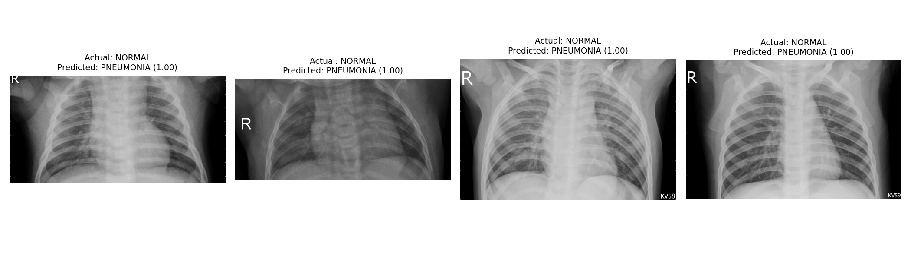
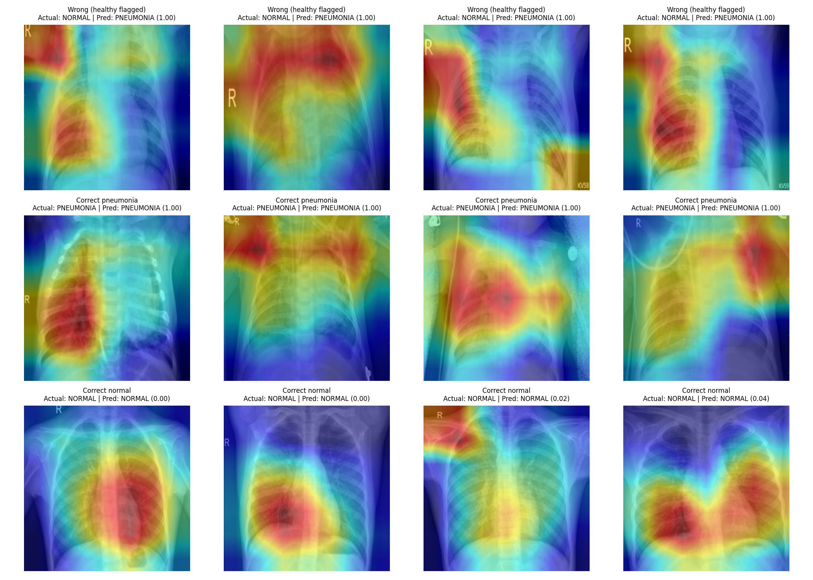

# 🫁 Chest X-ray Assistant

> ⚠️ **Not for medical diagnosis.** This is a portfolio/learning project. It must not be used to make decisions about anyone's health.

Upload a chest X-ray and the app:
1. **Classifies** it as NORMAL or PNEUMONIA (DenseNet121, transfer learning)
2. Shows a **Grad-CAM heatmap** of the regions that influenced the prediction
3. Writes a **short summary grounded in reference notes** (RAG with Chroma + Gemini), with a template fallback if the LLM is unavailable

**Live demo:** https://huggingface.co/spaces/YOUR_HF_USERNAME/medxray-assistant <!-- TODO -->

 <!-- TODO: record a 10-20 s GIF -->

## Architecture



The image is **never sent to the LLM**; only the label, probability and retrieved reference text are.

## Results (official test set, 624 images)

| Model | Accuracy | AUC | Pneumonia recall | Normal recall |
|---|---|---|---|---|
| **v1 (final)**: resize 224, class-weighted loss | **91.2%** | **0.975** | **99.2%** | **77.8%** |
| v2: + center crop + random erasing | 87.8% | 0.971 | 99.0% | 69.2% |

v1 confusion matrix: 3 pneumonia cases missed, **52 of 234 healthy X-rays wrongly flagged**.



## Failure cases and what Grad-CAM revealed




- Some heatmaps focus on **text markers burned into the image** (e.g. "R", "KV58") rather than the lungs. This suggests shortcut learning (the model using non-medical clues).
- I tried v2 (center crop + random erasing) to reduce this. In a single training run it **did not improve** results, so I kept v1 and report the issue here.

## Limitations

- **Children only:** trained on pediatric X-rays (ages 1-5) from a single hospital source (Kermany et al., 2018). It is not validated on adults or other hospitals.
- **Over-flags healthy X-rays:** normal recall is 77.8%.
- **Validation was optimistic:** validation accuracy was ~98% vs 91% on test. The train/validation split was by image, not by patient, so the same child can appear in both.
- Grad-CAM shows where the model looked, **not** where disease is.
- Single training run per model; no confidence intervals.

## Future work

- Patient-level train/validation split
- Mask or crop text markers; test on an external dataset (e.g. adult X-rays)
- Threshold tuning / probability calibration to reduce false positives
- Several training seeds and confidence intervals

## Run locally

```bash
python -m venv .venv
.venv\Scripts\activate            # Windows
pip install torch torchvision -r requirements.txt
set GEMINI_API_KEY=your_key       # optional; without it, the template summary is used
python app.py                      # open http://localhost:7860
```

## Project structure

```
app.py              Gradio app + per-visitor rate limit
src/inference.py    model loading, prediction, Grad-CAM
src/retrieval.py    notes -> chunks -> Chroma -> top-3 retrieval
src/summary.py      Gemini summary + template fallback
rag_docs/           reference notes (written in my own words, with sources)
model/model.pt      trained weights (v1)
Dockerfile          container for Hugging Face Spaces (port 7860)
```

## Data and references

- Dataset: Kermany et al., *Cell* 2018, "Identifying Medical Diagnoses and Treatable Diseases by Image-Based Deep Learning": https://doi.org/10.1016/j.cell.2018.02.010
- Grad-CAM: Selvaraju et al., 2017: https://arxiv.org/abs/1610.02391
